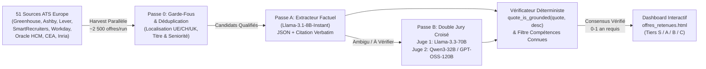

# 🧠 Jarvis — Personal Second Brain (FTS5 + Knowledge Graph) & Multi-Judge Grounded Career Engine

[](https://www.python.org/)
[](https://www.sqlite.org/fts5.html)
[](https://groq.com/)

> **FR :** Moteur hybride combinant :
> 1. **Un Second Cerveau Personnel local (`src/jarvis_brain.py`)** indexant l'intégralité de mes travaux académiques, rapports de recherche et dépôts de code via **SQLite FTS5 (`BM25` + `porter unicode61`)** et un graphe de connaissances relationnel.
> 2. **Un Moteur Européen d'Agrégation ATS & Filtrage IA Multi-Juges à Preuve Verbatim (`src/harvest_global.py` & `src/screening.py`)** interrogeant directement **51 APIs ATS publiques** (Greenhouse, Lever, Ashby, Workday, SmartRecruiters, Recruitee, Personio, Oracle HCM, Inria, CEA) en Europe et filtrant chaque offre via un comité de **3 LLMs distincts avec vérification déterministe de citations exactes (*anti-hallucination grounding*)**.
>
> **EN:** Hybrid personal knowledge base (**SQLite FTS5 BM25 + Knowledge Graph**) and **Multi-ATS European Career Engine** featuring a **2-Pass, 3-Model Grounded LLM Jury** that eliminates hallucinated rejections by enforcing verbatim substring verification on every extracted experience or skill blocker.

---

## 🏛️ Architecture du Pipeline Multi-ATS & Jury LLM Grounded



---

## ⚡ Innovations Clés (`src/screening.py` & `src/jarvis_brain.py`)

- **Jury Multi-Modèles à Preuve Verbatim (`quote_is_grounded`) :** Aucun juge LLM n'est autorisé à rejeter une offre pour motif d'expérience (`min_years_required > 1`) ou de langue/compétence bloquante sans fournir un extrait exact (`verbatim quote`) présent mot pour mot dans la description de l'offre. Un vérificateur déterministe contrôle l'inclusion de la sous-chaîne et neutralise les hallucinations sur les bornes supérieures (*"maximum of 2 years experience"*, *"0 to 3 years"*).
- **Protection contre l'Auto-Disqualification (`CANDIDATE_KNOWN_SKILLS_RX`) :** Empêche un LLM de déclarer manquante une compétence déjà maîtrisée par le candidat (`Python`, `PyTorch`, `SQL`, `Docker`, `Statistiques`, `C++`, `React`), tout en maintenant un blocage strict sur les langues étrangères non parlées (`Allemand C1`, `Néerlandais`) et les outils hors-spectre (`SAP`, `Salesforce`, `Power BI`).
- **Second Cerveau SQLite FTS5 (`src/jarvis_brain.py`) :** Recherche plein texte pondérée (`BM25` : poids `10.0` sur le titre, `5.0` sur le résumé, `3.0` sur les tags, `1.0` sur le corps) couplée à une table d'entités typées (`UV_UTC`, `STAGE`, `PROJET`, `CONCEPT_MATH_IA`, `COMPETENCE`) avec citations de preuves exactes.

---

## 🚀 Utilisation Rapide

```powershell
# 1. Interroger le Second Cerveau local (CLI)
python src/jarvis_brain.py search "Hoeffding classification sélective GMIC"
python src/jarvis_brain.py profile

# 2. Lancer la moisson européenne multi-ATS et le criblage Multi-Juges Groq
python src/harvest_global.py
```
